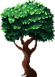
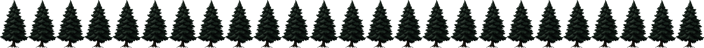
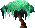

# Forest asset comparison — v1 (WIP)

This sheet compares **actual Karsiori CC0 PNG assets** against the existing procedural forest. It is not an in-game screenshot, and none of these candidate PNGs replaces the live Phaser trees yet.

**Open the visual review page:** `/forest-asset-review.html` after running `npm run dev`. The page draws actual source sprites over a simplified night-forest stage and exposes their native pixel sizes. No game mechanics are changed.

| Species role | Unmodified source sprite | Fit assessment |
| --- | --- | --- |
| Oak (broadleaf) |  | **Shortlist** — readable broad crown, `70×98`; requires carefully separating trunk/front occluder and normalizing to `96×220`. |
| Cedar / spruce |  | **Shortlist** — tall tapered silhouette, `74×128` per frame, **25 frames**, `1850×128` sheet; NIGHT edition has low contrast and needs visibility testing during Finale. |
| Willow-like comparison |  | **Not approved** — `35×28` is tiny for the principal game tree, and it lacks the tall hanging-branch structure of a mature willow. Kept to make the mismatch visible; source a proper willow before merge. |

## Provenance and license (CC0)

- Original artist for all three sprites: **Karsiori**.
- Official [15-tree pack](https://karsiori.itch.io/free-pixel-art-tree-pack): states CC0, commercial use and modification allowed; `Tree 6 GREEN` and `Tree 10 TEAL`.
- Official [animated spruce pack](https://karsiori.itch.io/spruce-tree-pack-pixel-art-animated): states CC0; large spruce NIGHT spritesheet.
- Verified public mirrors used solely to retrieve original sprite bytes:
  - Oak and willow-like: [Garden-Looper / Pixel Art Tree Pack](https://github.com/FronterGit/Garden-Looper/tree/main/Assets/Art/Pixel%20Art%20Tree%20Pack).
  - Spruce: [deepwood source PNG](https://github.com/denis23x/deepwood/tree/main/assets/sprites/tree).
- Source PNG blob checksums were verified identical after importing to this repository. No claim is made that the mirrors are the original distribution.

## Two-layer Phaser contract, next step

1. Reconstruct three **96×220** transparent tree back/front pairs centered on **trunk axis x=48** and separately inspect the mobile and desktop displayed sizes.
2. Keep broad crowns/branches behind the character (`depth=14`), but fixed bark/roots in front (`depth=28`); preserve the existing miss geometry from `treeGeometry.ts`.
3. Reject any foreground foliage over the mouth target; retain the same stable `DESKTOP_TREE_CENTERS` and `MOBILE_TREE_CENTERS`.
4. Revisit stage/HUD composition. The current stage crops canopies significantly; merely changing raw tree images cannot fix this.
5. Validate both lighting phases and Pixel 7 portrait/desktop browser screenshots; only then connect new asset keys and mark this Draft PR ready.

**Status:** asset selection and comparison implemented. The integrated forest art is **not finished**.
